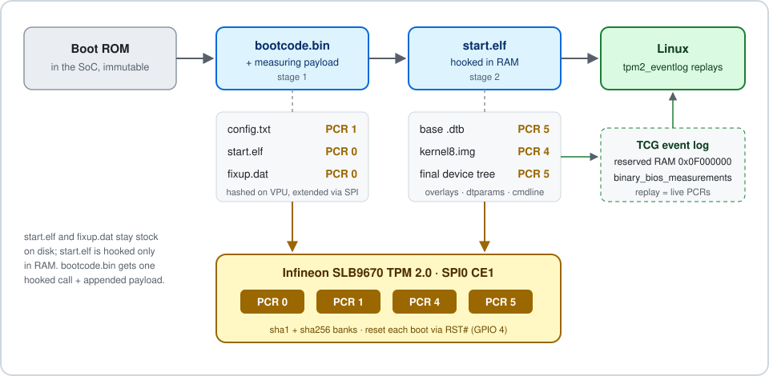

# Raspberry Pi 3 measured boot with a TPM 2.0

Measured boot for the Raspberry Pi 3 B+ and an Infineon SLB9670 TPM: every firmware file, the kernel
and the final device tree are hashed into TPM PCRs **before** they run, and Linux gets a standard TCG
event log that `tpm2_eventlog` replays to the live PCR values.

The Pi's boot chain is closed firmware that never talks to a TPM. This project adds the measurements
inside it: a small payload hooked into `bootcode.bin`, which in turn hooks `start.elf` in RAM.
Measured boot only: nothing is enforced, no OTP or secure-boot settings are touched.



| PCR | Contents | Measured by |
|---|---|---|
| 0 | `start.elf`, `fixup.dat` | bootcode.bin payload |
| 1 | `config.txt` | bootcode.bin payload |
| 4 | `kernel8.img` (and initramfs, armstub, `kernel=` file) | start.elf hook |
| 5 | base `.dtb`, then the **final device tree** (overlays, dtparams, kernel command line) | start.elf hook |

The TPM is reset through its RST# line at every boot, so warm reboots give the same PCRs as cold boots.

## Get it

Download the [latest release](../../releases) (our code only, no Broadcom firmware), then build a
`bootcode.bin` from the official stock firmware. This runs anywhere with Python 3, including the Pi:

```bash
tar xzf rpi3-tpm-measured-boot-*.tar.gz && cd rpi3-tpm-measured-boot-*
./make-bootcode.py      # downloads raspi-firmware 1:1.20260915-1, checks hashes, writes ./bootcode.bin
```

Install on the boot partition, next to the stock `start.elf`/`fixup.dat` from the same package:

```
bootcode.bin                      (from make-bootcode.py)
overlays/tpm-eventlog.dtbo        event log handed to Linux
overlays/tpm-rst-guard.dtbo       keeps userspace away from the TPM reset pin
```

`config.txt`:

```ini
dtparam=spi=on
dtoverlay=tpm-slb9670
dtoverlay=tpm-eventlog
dtoverlay=tpm-rst-guard
enable_uart=1          # optional: firmware measurement log on the serial console
uart_2ndstage=1
```

Then, on the Pi:

```bash
sudo tpm2_eventlog /sys/kernel/security/tpm0/binary_bios_measurements   # events + replayed PCRs
tpm2_pcrread sha256:0,1,4,5                                             # must equal the replay
```

The full install guide ships in the release as `README.md` ([firmware/INSTALL.md](firmware/INSTALL.md)).

## Requirements and status

- **Firmware pinned:** `raspi-firmware` 1:1.20260915-1 (Raspberry Pi OS 2026-10-06). Other versions
  are refused by the patcher; after a firmware update the start.elf stage is skipped (boot continues).
- **Hardware:** Pi 3 B+, SLB9670 on SPI0 CE1 with RST# on GPIO 4 (check your board:
  `tests/probe-tpm-reset-gpio.sh`).
- **Tested** with network boot, cold and warm boots, and a tamper matrix where each changed input moves
  exactly the expected PCRs ([docs/testing.md](docs/testing.md)). **SD-card boot is untested.**
- Read [docs/security.md](docs/security.md) before relying on it: the design fails open, and root can
  still reset the TPM through `/dev/mem`.

## Repository

| Path | |
|---|---|
| [`firmware/`](firmware/) | the payload (`tpm-measure.s`, VideoCore IV assembly), patcher, overlays, release tooling |
| [`docs/`](docs/) | [how it works](docs/how-it-works.md) · [security](docs/security.md) · [testing](docs/testing.md) · [firmware notes](docs/reverse-engineering.md) · [test rig](docs/test-rig.md) · [U-Boot (experimental)](docs/uboot.md) |
| [`netboot/`](netboot/) | Docker netboot server (DHCP/TFTP/NFS) used to develop and test on a Pi without an SD card |
| [`tests/`](tests/) | tamper matrix and TPM reset-pin probe |
| [`tools/`](tools/) | VideoCore binutils, hub power control, final-DT verifier, U-Boot build |

Build from source: `docker build -t vc4-binutils tools/vc4 && firmware/build.sh`.

## Licence note

The Broadcom firmware may only be redistributed unmodified, so this repository and its releases never
contain `bootcode.bin` or `start.elf`, patched or not. `make-bootcode.py` fetches the stock file from
Raspberry Pi's archive and patches it locally; keep the result for your own use.
