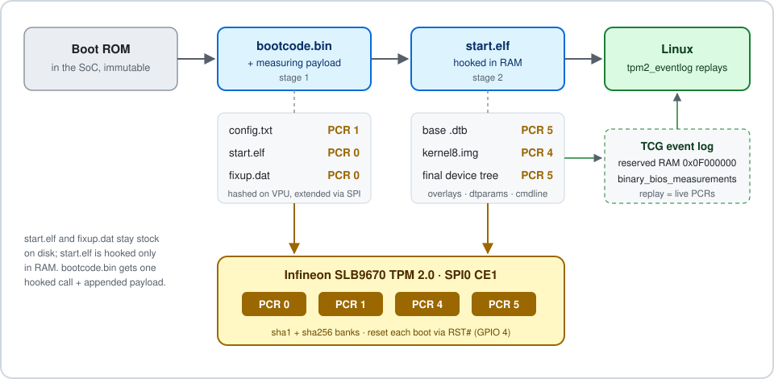

# How it works

The Pi 3 has no measured boot: its ROM, `bootcode.bin` and `start.elf` run before Linux ever sees the
TPM, and nothing extends a PCR. This project adds measurement inside the closed firmware itself, with
one small code payload appended to `bootcode.bin`. Measured boot only: no OTP, signed-boot or boot
flags are touched, and every displaced firmware instruction is still executed.

## Stage 1: inside bootcode.bin

`bootcode.bin` (VideoCore IV code, loaded by the ROM into L2 at `0x80000000`) calls
`0x80001720(buffer, length)` right after every file it reads, the hook its own (disabled) signed-boot
code uses. One instruction at `0x80001662` is redirected to our payload at `0x80010000` (appended to
the file). For each file the payload:

1. on first use, pulses the TPM's RST# (GPIO 4 on this board) so every boot, warm or cold, starts from
   zeroed PCRs, then sends `TPM2_Startup(CLEAR)`;
2. hashes the file with SHA-256 and SHA-1;
3. sends one `TPM2_PCR_Extend` with both digests over SPI0 (TIS-over-SPI, locality 0);
4. appends a TCG event to the event log;
5. calls the original `0x80001720` with the original arguments.

`config.txt` goes to PCR 1, `start.elf` and `fixup.dat` to PCR 0.

## Stage 2: inside start.elf

`start.elf` is never modified on disk. After `fixup.dat` is measured, `start.elf` sits unrelocated in
RAM at `0xC0100000`; stage 1 patches 20 bytes of it there, after checking they are the expected
instructions (and that no `fixup.dat` relocation touches them):

- `0x0ED7A164` (16 bytes, in `load_file()` after `fread`): `mov r5,load_hook; bl r5;
  mov r5,dt_hook; b r5`. The load hook does the displaced `fclose` and conditional branch itself.
- `0x0ED79E8E` (4 bytes, just before the ARM is released): `bl 0x0ED7A16C`.

Stage 1 copies the whole payload to reserved SDRAM (`0x0F008000`) and stage 2 runs from there (L2
contents do not survive into start.elf). Stage 2 reuses the same measuring code, with start.elf's own
SHA-256 and logger:

| Measured | PCR | Event type |
|---|---|---|
| every file start.elf loads: the DTB | 5 | `EV_TABLE_OF_DEVICES` |
| … kernel, initramfs, armstub, `kernel=` (e.g. u-boot.bin) | 4 | `EV_IPL` |
| the **final device tree** the kernel receives | 5 | `EV_TABLE_OF_DEVICES` |

The final device tree covers overlays, dtparams and the kernel command line (`/chosen/bootargs`). It is
hashed from a copy (Linux gets the real one) with three per-boot properties replaced by `FDT_NOP`
tokens: `/chosen/rng-seed` and `/chosen/kaslr-seed` (random; the kernel NOPs `rng-seed` itself after
use) and `/chosen/bootloader/rsts` (reset reason, `0x1000` cold, `0x1020` warm). Alignment padding,
which start.elf leaves uninitialised, is zeroed. `tools/verify/final-dt-digest.py` reproduces the
digest from `/sys/firmware/fdt`.

## Event log

Measurements are recorded as a TCG crypto-agile event log (`Spec ID Event03` header, one
`TCG_PCR_EVENT2` with SHA-1 and SHA-256 digests per file, file name as event data) at physical
`0x0F000000`. The `tpm-eventlog` overlay reserves `0x0F000000-0x0F02FFFF` (log 32 KB, stage-2 code
32 KB, final-DT scratch 64 KB) and sets `linux,sml-base`/`linux,sml-size` on the TPM node. The kernel
then exposes it as `/sys/kernel/security/tpm0/binary_bios_measurements`, and `tpm2_eventlog` replays it
to the live PCR values.

## Memory map

| Address (VPU) | Use |
|---|---|
| `0x80000000-0x8000D708` | bootcode.bin code, data, stack (L2) |
| `0x80010000` | payload (appended to the file, zero-padded to 64 KB) |
| `0x80014000-0x80015CFF` | stage-1 scratch: TPM buffers, SHA state, event log being built |
| `0xC0100000` / `0xC0080000` | start.elf / fixup.dat file buffers (SDRAM, uncached) |
| `0x0F000000` / `0x0F008000` / `0x0F010000` | event log / stage-2 code copy / final-DT scratch (reserved for Linux) |

## Cost

About 6 s added to boot: start.elf (3 MB) 2.1 s in stage 1, kernel (10 MB) 3.8 s in stage 2. The TPM
itself hashes at only ~400 KB/s, so hashing is done on the VPU and only digests go to the TPM.

## Limits of the design

It fails open: if the TPM does not answer, or the start.elf bytes are not the expected ones (a
different `start_file`, a firmware update), boot continues and the missing measurements show up only
as missing events. See [security.md](security.md).

Source: [`firmware/tpm-measure.s`](../firmware/tpm-measure.s). Firmware internals and addresses:
[reverse-engineering.md](reverse-engineering.md).
